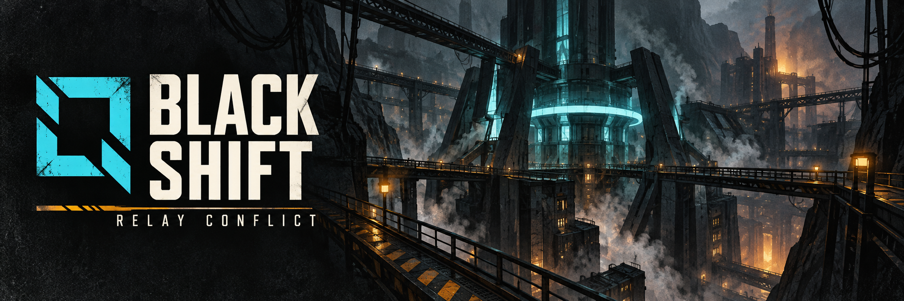
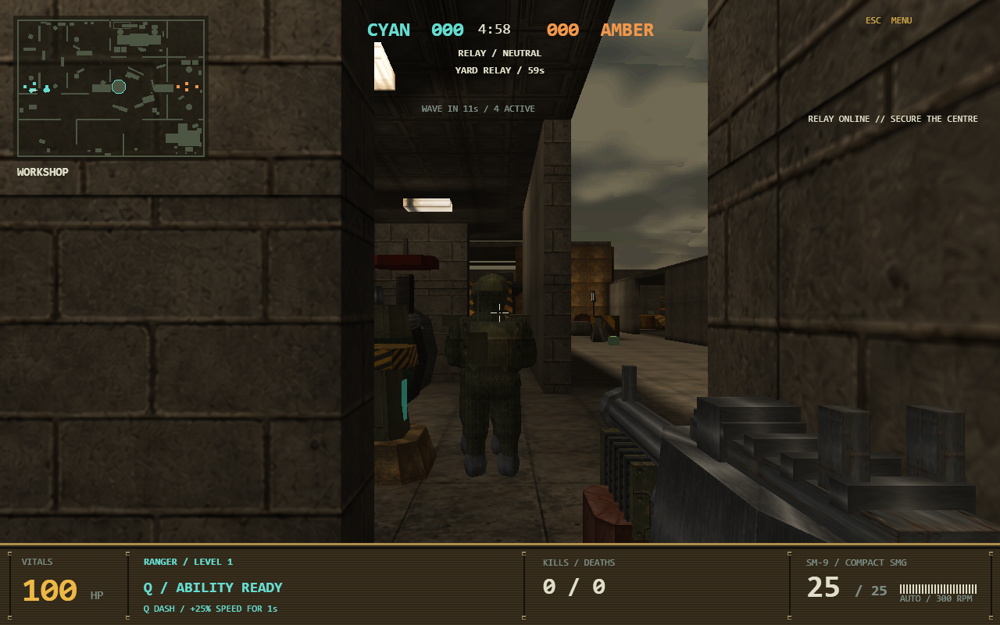
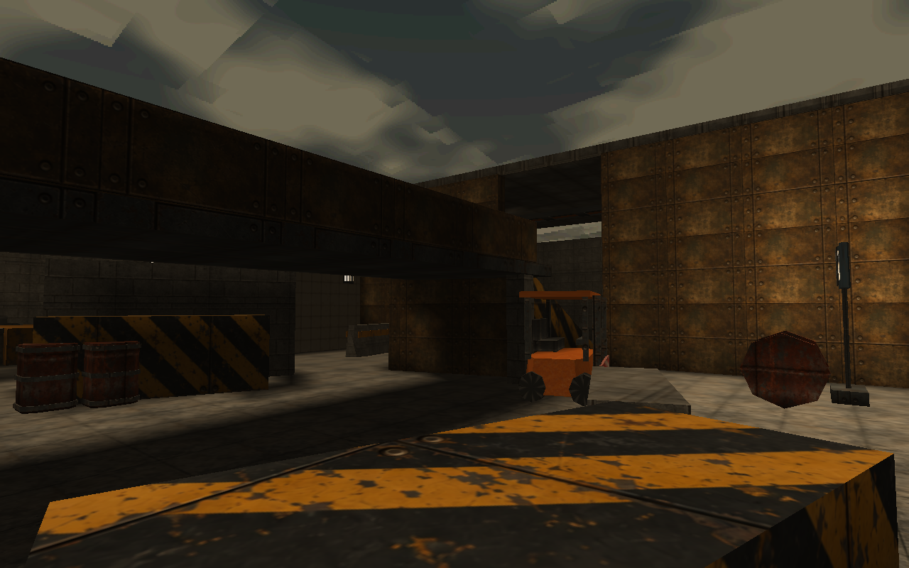
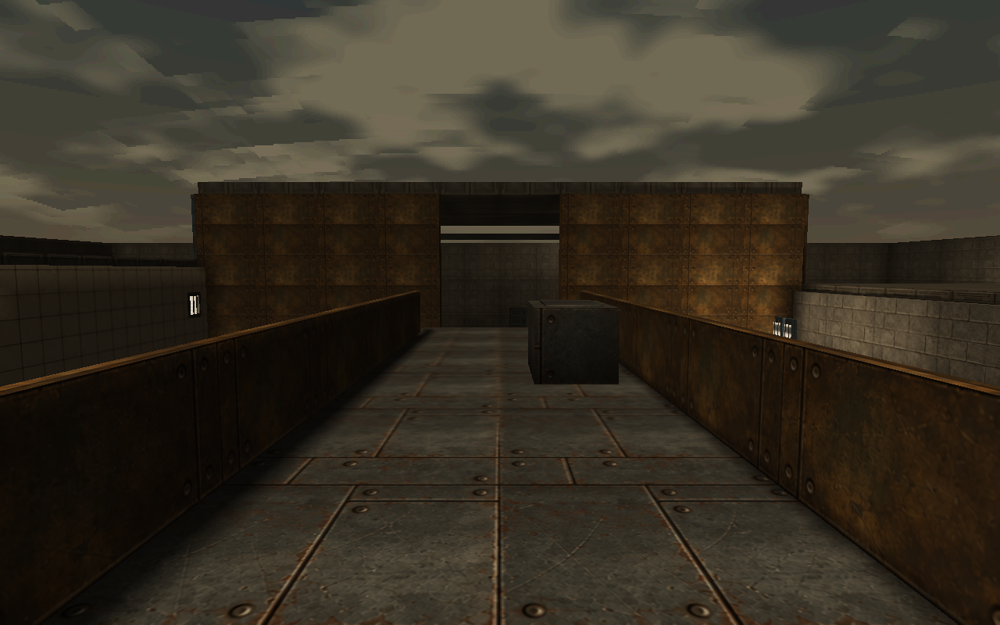
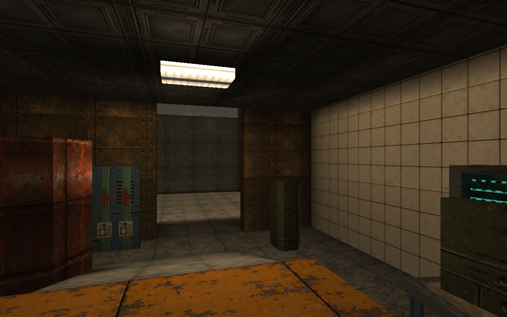
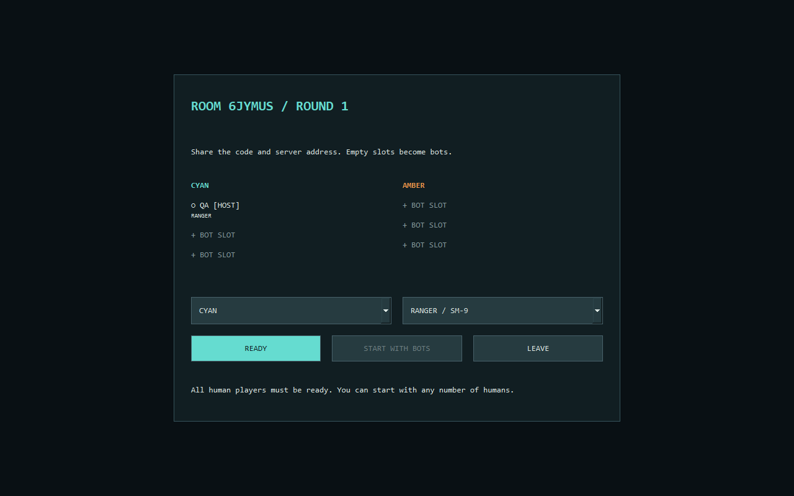
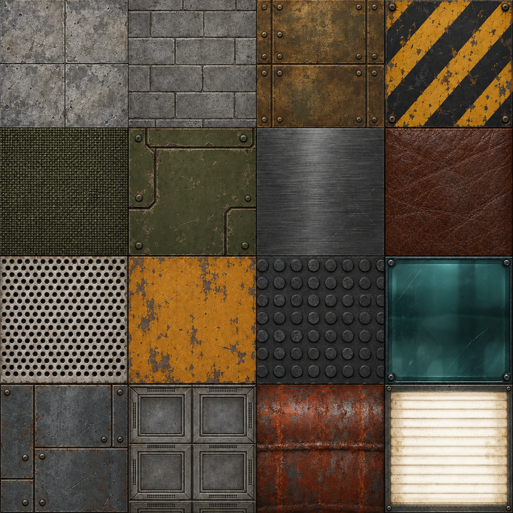
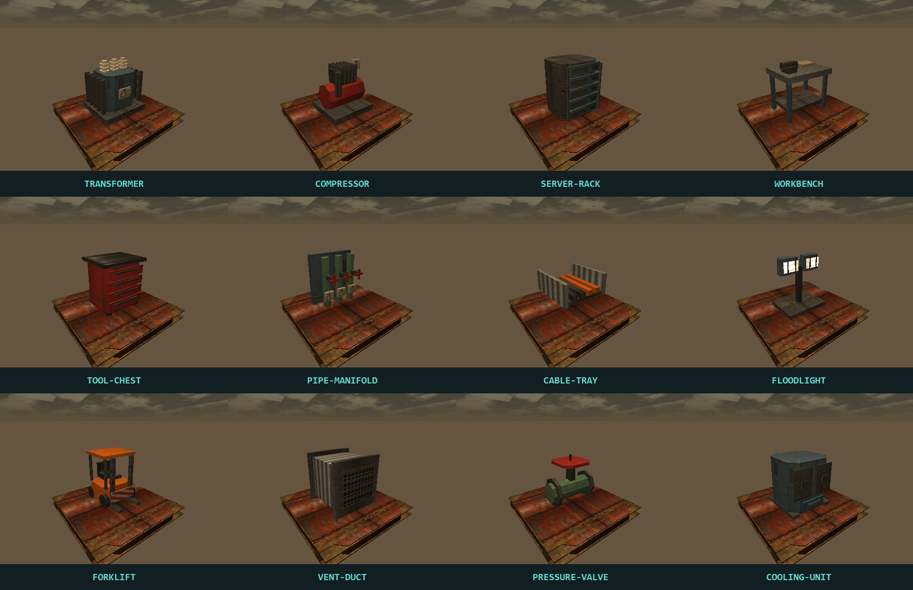
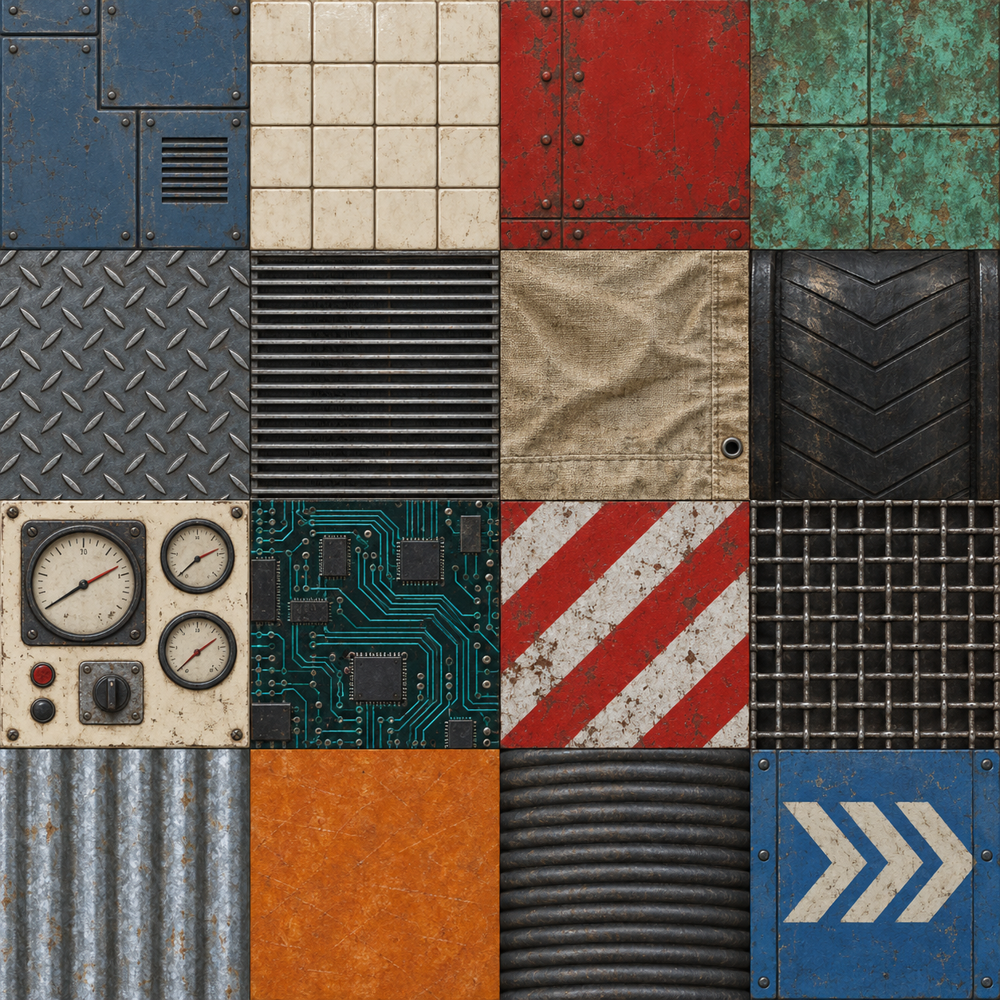

<div align="center">



**Захвати реле. Удержи завод. Сломай оборону.**

Командный FPS в индустриальной ретро-эстетике · Авторитетный сервер · Открытый исходный код

[](https://github.com/villetacore/black-shift/actions/workflows/ci.yml)
[](LICENSE)
[](#состояние-проекта)
[](client/app)
[](server)
[](client/core)

[**Скачать**](https://github.com/villetacore/black-shift/releases) · [**Запуск**](#быстрый-старт) · [**Разработка**](#сборка-из-исходников) · [**План развития**](docs/development-roadmap.md) · [**Участие**](CONTRIBUTING.md)

<sub>Обложка — иллюстрация. Ниже — реальные кадры OpenGL-клиента.</sub>

</div>

---

## Внутри BLACK SHIFT

Бой идёт за узлы промышленного комплекса. Активное реле перемещается каждую минуту: занимай высоты, перекрывай подходы, меняй позицию раньше противника. Дроны давят на базу, башни прикрывают ядро, а два класса по-разному решают задачи атаки и поддержки.

| ◈ Реле и маршруты | ⌖ Стрельба и движение | ⚙ Промышленный мир |
|:---|:---|:---|
| Захват, спорная точка, предупреждение ротации и очки удержания | Отдача, магазины, дробь, зоны попаданий, рывок и инерция | Галереи, насосная, лестницы, вода и оригинальные процедурные модели |
| **Комнаты 3 на 3**, дуэль и практика | SM-9 и SG-12 с разным характером боя | Карта **Foundry Heights**, 60 × 44 м |

> **Новая итерация в исходниках:** приватные комнаты до шести игроков, боты и реванш со сменой сторон; **12 новых моделей** оборудования и **16 новых материалов** — всего 32. Сохранены 12 звуковых эффектов и настройки **F10**. [Что сделано →](docs/iteration-02.md) Архивы прошлых релизов могут отличаться.

## Кадры из игры

<p align="center">
  
</p>

<table>
  <tr>
    <td width="50%"><br><b>Foundry Heights</b> · открытый двор и верхние маршруты</td>
    <td width="50%"><br><b>Галерея</b> · контроль высоты</td>
  </tr>
  <tr>
    <td><br><b>Насосная</b> · ближние дистанции</td>
    <td><br><b>Комната</b> · стороны, классы, готовность</td>
  </tr>
</table>

## Два класса — два стиля

| | **RANGER** | **WARDEN** |
|:---|:---|:---|
| Роль | Обход и перехват | Удержание и поддержка |
| Оружие | **SM-9**, магазин 25 патронов | **SG-12**, 6 патронов, зарядка по одному |
| Способность | **Q:** рывок и краткое ускорение после успешного перемещения | **Q:** лечение себя и видимых союзников |
| Особенность | Управление дистанцией и быстрый выход на позицию | **Shift + Q:** атакующий импульс вместо лечения |
| Перезарядка способности | 8 секунд | 8 секунд, общая для двух режимов |

Уровни 1–5 увеличивают здоровье и урон. Баланс классов, сторон и прогрессии ещё проходит проверку.

## Как победить

1. **Захвати реле:** удерживай точку без врага 2 секунды.
2. **Защищай:** присутствие команды приносит 1 очко в секунду и ещё 5 за каждые 15 секунд непрерывного удержания. Пустая или спорная точка очков не даёт.
3. **Следи за ротацией:** следующая точка отмечается за 15 секунд до перехода.
4. **Работай с волнами:** каждые 12 секунд появляются дроны. Полная зачистка вражеской волны даёт команде 4 очка.
5. **Заверши матч:** уничтожь ядро, набери 200 очков или веди по счёту через 5 минут. Пока башня стоит, ядро защищено.

## Быстрый старт

Скачай архив со страницы [Releases](https://github.com/villetacore/black-shift/releases) и распакуй. Внутри — клиент, сервер и лаунчер. Лаунчер запускает локальную тренировку и останавливает сервер при закрытии игры.

| Система | Архив | Запуск |
|:---|:---|:---|
| Windows 10/11 x64 | `BlackShift-<версия>-windows-x64.zip` | `Play.cmd` |
| Linux x64, glibc 2.39+, X11/XWayland | `BlackShift-<версия>-linux-x64.tar.gz` | `./play.sh` |
| macOS 14+, Apple Silicon | `BlackShift-<версия>-macos-arm64.zip` | `Play.command` |

Нужен драйвер с **OpenGL 2.1**. На macOS сборка не подписана: после распаковки сними карантин командой `xattr -dr com.apple.quarantine BlackShift-*-macos-arm64`.

<details>
<summary><b>Подключение к своему серверу и параметры запуска</b></summary>

```sh
./play.sh --online
./play.sh --no-server --server 192.168.1.10:7777
./play.sh --name Bravo --role warden
```

Windows:

```powershell
.\Play.ps1 -Online
.\Play.ps1 -NoServer -Server 192.168.1.10:7777
.\Play.ps1 -Name Bravo -Role warden
```

**DUEL 1VS1** объединяет двух ожидающих игроков. **PRIVATE ROOM** открывает комнату до шести: оставь код пустым для создания или введи код друга для входа. Все участники используют один адрес сервера. Выбери сторону и класс, нажми **READY**; владелец запускает матч, свободные места занимают боты. После результата стороны меняются и доступен реванш. Вход во время матча пока закрыт.

</details>

## Управление

| Клавиши | Действие | Клавиши | Действие |
|:---|:---|:---|:---|
| **W A S D** | Движение | **Мышь / ← →** | Обзор |
| **Shift** | Бег вперёд на земле | **Space** | Прыжок / всплытие |
| **C / Ctrl** | Присесть | **ЛКМ** | Стрельба |
| **R** | Перезарядка | **Q** | Способность |
| **Shift + Q** | Атакующий импульс Warden | **Tab** | Таблица игроков |
| **F10** | Настройки | **F11** | Полный экран |
| **Esc** | Отпустить / захватить курсор | **Enter** | Выйти из матча при отпущенном курсоре |

**Настройки:** чувствительность мыши, инверсия по вертикали, вертикальный FOV 50–90° и громкость. Сохраняются локально. Окно настроек не останавливает сетевой матч.

В глубокой воде удерживай Space для всплытия; взгляд вниз и движение вперёд позволяют нырять.

## Звук и материалы

<table>
<tr>
<td width="36%"></td>
<td>

**32 материала** — два атласа: бетон, сталь, броня, ткань, кожа, приборные панели, керамика, медь, резина и сетки. Клиент использует отдельные тайлы 256 × 256 с mipmaps.

**39 моделей в реестре** — Rust-генератор, экспорт OBJ/SMD. Новый набор из 12 моделей включает погрузчик, трансформатор, стойку серверов, верстак и трубный коллектор; оборудование размещено на карте.

**12 WAV-эффектов** — оружие, шаги, перезарядка, попадания, способности и сигналы реле. Стереопанорама и затухание по расстоянию; до 32 одновременных голосов.

[Происхождение и воспроизведение ассетов →](docs/asset-production.md)

</td>
</tr>
</table>

<p align="center"></p>

<details>
<summary><b>Новый атлас оборудования · 16 материалов</b></summary>



</details>

## Архитектура

```text
                      TCP / JSON Lines
 C++ · Qt · OpenGL  ◄────────────────────►  Elixir / OTP
       клиент                              сервер · 20 Гц
          │                                  │
   Rust staticlib                       Симуляция матча
   модели и анимация                    Коллизии · бой · ИИ
                                             │
                                          Mnesia
                                     результаты матчей
```

Сервер определяет движение, попадания и исход матча. Клиент рисует мир, сглаживает положение и воспроизводит подтверждённые события. Компенсация задержки попаданий использует историю серверных состояний; полноценное предсказание движения ещё запланировано.

| Каталог | Назначение |
|:---|:---|
| [server/](server) | Симуляция, сеть, подбор, навигация и результаты |
| [client/app/](client/app) | Qt-клиент, ввод, HUD, OpenGL, стереомикшер |
| [client/core/](client/core) | Процедурные модели, скелетная анимация, генераторы |
| [assets/](assets) | Текстуры, WAV и экспортированные модели |
| [scripts/](scripts) | Сборка, тестирование, запуск и упаковка |
| [docs/](docs) | Форматы, архитектура и планы |

## Сборка из исходников

**Зависимости:** Erlang/OTP 27+, Elixir 1.18+, Rust, CMake ≥ 3.24, Qt ≥ 6.4 с Widgets, Network, OpenGL, OpenGLWidgets и **Multimedia**. Windows также требует Visual Studio C++ tools и MSVC toolchain Rust.

<details open>
<summary><b>Windows / PowerShell</b></summary>

```powershell
# Локальные Erlang и Elixir
.\scripts\install-beam.ps1

# Qt с аудиомодулем
uv tool run --from aqtinstall aqt --config scripts/aqt.ini install-qt windows desktop 6.8.3 win64_msvc2022_64 -O build/deps/Qt --modules qtmultimedia

# Сборка и тесты
.\scripts\build.ps1 -TestClient
.\scripts\play.ps1

# Архив для распространения
.\scripts\package.ps1
```

Для уже установленного Qt: `.\scripts\build.ps1 -QtPath C:\Qt\6.8.3\msvc2022_64`.

</details>

<details>
<summary><b>Linux / macOS</b></summary>

Ubuntu 24.04:

```sh
sudo apt install qt6-base-dev qt6-base-dev-tools qt6-multimedia-dev libgl-dev ninja-build
(cd server && mix test --warnings-as-errors && MIX_ENV=prod mix release --path ../build/server)
cmake -S . -B build/client -DCMAKE_BUILD_TYPE=Release
cmake --build build/client --parallel
scripts/package.sh
```

На macOS установи Qt с модулем Multimedia через Qt installer или aqt; затем выполни команды сборки сервера и клиента выше. Команды установки apt относятся только к Linux.

</details>

<details>
<summary><b>Собственный сервер</b></summary>

Docker-образ публикуется workflow релиза для linux/amd64 и linux/arm64. Точное имя и тег смотри в описании выбранного релиза; локальная сборка доступна через:

```sh
docker compose up -d
```

Из распакованного архива:

```sh
export BS_BIND=0.0.0.0 BS_PORT=7777 BS_DB_DIR=$PWD/data/mnesia
server/bin/blackshift start
server/bin/blackshift stop
```

На Windows используй `server\bin\blackshift.bat`.

| Переменная | По умолчанию | Назначение |
|:---|:---|:---|
| `BS_BIND` | `127.0.0.1` | Адрес; `0.0.0.0` — доступ по сети |
| `BS_PORT` | `7777` | Игровой TCP-порт |
| `BS_DB_DIR` | `data/mnesia` | Каталог результатов |
| `RELEASE_NODE` | `blackshift@localhost` | Постоянное имя узла для базы |

Административная связь Erlang ограничена loopback.

</details>

## Состояние проекта

**BLACK SHIFT — работающий прототип в активной доработке.** Это ещё не готовый соревновательный сервис.

- Есть тренировка с ботами, онлайн-дуэль, приватные комнаты до шести, реванш со сменой сторон, два класса, сборки и тесты.
- Нет аккаунтов, рейтинга, переподключения и входа в идущий матч.
- Нет полноценного предсказания движения, TLS и UDP.
- Снимки пока раскрывают позиции всех участников; защита от wallhack не реализована.
- Пространственный звук использует панораму и расстояние; акустического перекрытия стенами пока нет.
- Живые матчи хранятся в памяти. Баланс, интернет-задержки и нагрузочная ёмкость требуют дальнейшей проверки.
- Сборки Linux/macOS проходят CI, но это не заменяет проверку запуска на реальных устройствах.

**Следующий рубеж:** телеметрия очков → командный плейтест реле и базы → доводка карты и баланса → предсказание движения и проверка сети.

[Полный план и критерии готовности →](docs/development-roadmap.md)

## Документация и участие

| Разобраться | Помочь проекту |
|:---|:---|
| [Архитектура](docs/architecture.md) · [Протокол](docs/protocol.md) | [Как внести изменения](CONTRIBUTING.md) |
| [Формат карты](docs/scene-format.md) · [Рендер](docs/rendering.md) | [Сообщить об ошибке](https://github.com/villetacore/black-shift/issues) |
| [Ассеты](docs/assets.md) · [Производство контента](docs/asset-production.md) | [История изменений](CHANGELOG.md) |
| [Тестирование](docs/testing.md) · [Геймплей](docs/gameplay-plan.md) | [План развития](docs/development-roadmap.md) |

При сообщении об ошибке приложи ОС, версию игры, класс, режим и шаги воспроизведения. Для баланса особенно полезны видео матча и обмен сторон в повторной игре.

---

<div align="center">

**BLACK SHIFT / RELAY CONFLICT**

Сделано на C++, Rust и Elixir. Исходный код — [MIT](LICENSE).

</div>
