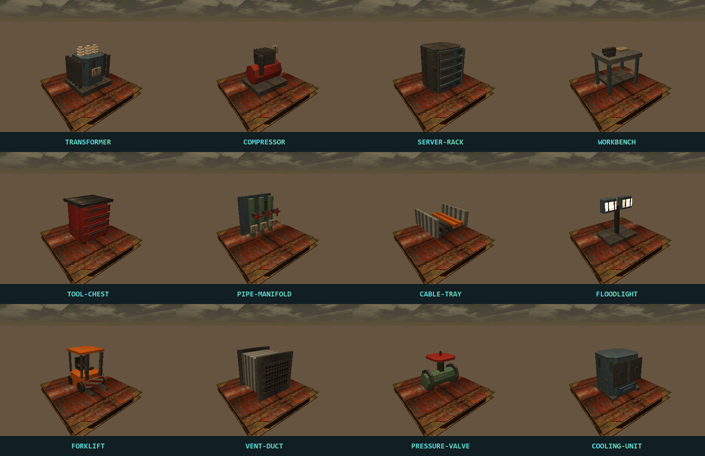

# Итерация 02 — комнаты и оборудование

17 октября 2026 года.

## Реализовано

- Приватные комнаты: шестизначный код, до шести человек, две команды по три места.
- Выбор стороны и класса, готовность, запуск владельцем. Пустые места занимают боты.
- После результата участники остаются в комнате, стороны меняются, готовность сбрасывается. Можно сразу начать реванш.
- При выходе владельца права переходят следующему участнику; пустая комната удаляется. При аварии матча участники возвращаются в комнату.
- 12 новых процедурных моделей: трансформатор, компрессор, серверная стойка, верстак, инструментальная тележка, трубный коллектор, кабельный лоток, прожектор, погрузчик, воздуховод, вентиль и охладитель.
- Второй атлас: 16 новых материалов, всего 32. Геометрия использует собственные UV для новых материалов.
- На Foundry Heights добавлены 21 объект и два источника света, заменены семь старых моделей оборудования. Всего 174 объёма карты.
- Экспорт OBJ/MTL поддерживает оба атласа. Клиент берёт геометрию непосредственно из Rust-кода.

## Как играть вместе

1. Запустить сервер, доступный всем участникам; указать один адрес сервера в меню клиентов.
2. Нажать **PRIVATE ROOM**. Пустой код создаёт комнату; существующий код присоединяет к ней.
3. Поделиться кодом и адресом сервера. Выбрать сторону и класс, нажать **READY**.
4. Владелец нажимает **START WITH BOTS**. Даже один человек может начать полноценный матч 3 на 3.
5. После результата снова подтвердить готовность и начать **START REMATCH**.

Код относится к конкретному серверу; это не глобальный каталог серверов. Вход в уже идущий матч и переподключение не реализованы. Комнаты хранятся в памяти и исчезают при перезапуске сервера. Выход из матча закрывает соединение.

## Проверка и следующий шаг

74 серверных теста проходят: включая заполнение шестью людьми, отказ седьмому, ограничения команд, права владельца, готовность, запуск с ботами, смену сторон, реванш и восстановление после аварии матча. Навигационные проверки покрывают доступность целей и подборов; при расстановке устранено перекрытие подбора погрузчиком.

Следующий пункт плана — телеметрия источников очков и плейтест с людьми. Автоматические проверки комнат и маршрутов не подтверждают баланс нового оборудования, читаемость всех ракурсов и сетевое качество при интернет-задержках.

Нативный QtTest: 6 passed, 0 failed; проверены комната и запуск с ботами, движение, звук и рендер 12 моделей. Rust: 7 тестов и Clippy без предупреждений. Windows-архив: `dist/BlackShift-0.3.0-dev.20261017-windows-x64.zip` (распаковать и запустить `Play.cmd`). Linux/macOS локально не проверялись.
